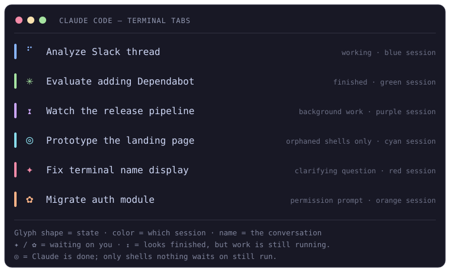

# claude-code-terminal-signals

Tell your [Claude Code](https://claude.com/claude-code) sessions apart at a glance — straight from the terminal tab bar.

Three small, independent features:

1. **Attention glyphs** — a glyph prefix tells you what each session wants from you, alongside the **conversation name** (not the folder):
   - `✦ <name>` — Claude is asking a clarifying question (`AskUserQuestion`)
   - `✿ <name>` — Claude is waiting for you to approve a tool/permission
   - `⧗ <name>` — Claude finished replying but left work running in the background (a shell or a subagent), so it isn't your turn yet (replaces the native `✳`)
   - `◎ <name>` — Claude is finished, but a shell left behind by a subagent that already ended is still running (a dev server, a forgotten `sleep`); kill it from `/tasks` when you're done with it

   The same check gates "finished" sounds: with [peon-ping](https://github.com/PeonPing/peon-ping), the done sound plays only when the tab really reads `✳`. See [Sound hooks](#sound-hooks).
2. **Unique bar color per session** — every new interactive `claude` session opens with a different `/color`, so tabs are visually distinct at a glance.
3. **Powerline statusline**: one bar under the prompt with the model, folder, git branch, the PRs and Linear issue the session is working on, plan usage, and context and prompt-cache health. See [Statusline](#statusline).

## Demo



*Two sessions need you (`✦`, `✿`) and three don't (`⠋`, `✳`, `⧗`) — and each is a different color. You can tell which is which without opening any of them.*

> Mockup illustrating the states. To drop in a real recording, save a GIF/PNG to `docs/` and point this `` at it.

### Tab states at a glance

By default, Claude Code already labels the tab with the conversation's AI-generated title and animates a working/idle indicator — so you can tell sessions apart by *what they're about*, not just by folder. This repo adds the two states where Claude is **blocked on you**, plus one where the native indicator would mislead you:

| Prefix | State | Source |
| --- | --- | --- |
| `⠋` — moving braille dot (animated) | Working / generating | Claude Code (built-in) |
| `✳` | Finished — idle, waiting for your next message | Claude Code (built-in) |
| `⧗` | Finished replying, but background work is still running | **this repo** |
| `◎` | Finished; only shells orphaned by finished subagents are still running | **this repo** |
| `✦` | Asking a clarifying question (`AskUserQuestion`) | **this repo** |
| `✿` | Waiting for you to approve a permission | **this repo** |

All five show alongside the **conversation name**. `✦` and `✿` are emitted as an **OSC 0** title escape returned from a hook (`{"terminalSequence":"]0;…"}`). They fire mid-turn, while Claude is blocked on you and not retitling, so the glyph sticks.

`⧗` can't work that way. It fires on `Stop`, and Claude Code writes its own `✳` title *after* it processes hook output — so a title returned from a `Stop` hook is emitted and then immediately overwritten. Instead `term-busy.sh` writes nothing to stdout and hands off to `term-defer.sh`, a detached helper that waits for Claude to report the turn finished (its `status` in `<config>/sessions/<pid>.json` stops reading `busy`, ~120 ms after the hook runs), lets the native title land, and only then writes the glyph to the tty that owns the tab. That wait doubles as the check for whether the `⧗` is still warranted — the same `status` says whether a background shell is running. If the turn has resumed by then it writes nothing, so a stale `⧗` can never sit on a working session.

The working (moving dot) and finished (`✳`) indicators are Claude Code's built-in tab status, set through its **own** title mechanism (process-level / OSC 2) — a different path than the hook's, which is why they coexist, and why a hook glyph gives way as soon as Claude writes its next native title. Those native glyphs aren't officially documented and may vary by version/terminal; they're listed here only so the full vocabulary lives in one place. The per-session color (feature 2) is independent of all of these.

---

## Why

When you run several Claude Code sessions in split terminals/tabs, they all look the same and you can't tell which one is blocked on your input. Claude's native tab title shows the conversation name + a working spinner — but the moment a session asks a question or requests permission, there was no at-a-glance cue, and some title hooks would even fall back to showing the *folder* name. This fixes both: a clear glyph when a session needs you, with its real conversation name, plus a distinct color per session.

The `✳` "finished" mark has the mirror problem — it appears the moment Claude stops writing, including when Claude ended the turn on purpose to wait on background work: a shell (`gh run watch`, a test suite, a deploy tail) or a subagent. The session isn't done and will wake itself up when that work finishes, so the tab is calling you over for nothing. `⧗` says "still working, don't bother".

---

## Requirements

- **Claude Code** v2.1.141+ (`claude` CLI) — the attention glyphs rely on the `terminalSequence` hook output, which older versions don't emit.
- **python3** — used by the hooks (JSON parsing, process scan) and the installer.
- **zsh** — required only for the per-session color feature. The attention-glyph hooks are shell-agnostic.
- **jq**, a [Nerd Font](https://www.nerdfonts.com/) and a truecolor terminal, for the statusline only.
- macOS or Linux. (The glyphs use OSC title escapes supported by standalone terminals like iTerm2, Terminal.app, Ghostty, Warp, etc. The VS Code / Cursor integrated terminal needs one extra setting — see [Cursor / VS Code integrated terminal](#cursor--vs-code-integrated-terminal).)

---

## Install

```sh
git clone https://github.com/fguinez/claude-code-terminal-signals.git
cd claude-code-terminal-signals
./install.sh
```

Then:
- Restart Claude Code (or start a new session) so the hooks load.
- `source ~/.zshrc` (or open a new terminal) to enable per-session colors.

Options:

```sh
./install.sh --no-color            # skip the per-session color wrapper
./install.sh --no-hooks            # skip the attention glyphs (hooks)
./install.sh --no-statusline       # skip the statusline
./install.sh --replace-statusline  # take over a statusLine you already have
./install.sh --dir PATH            # custom install dir (default: ~/.claude/terminal-signals)
```

The installer is **idempotent** and **non-destructive**: it backs up `settings.json` before editing and only touches the hook entries it owns (anything referencing `term-title.sh` / `term-perm.sh` / `term-busy.sh` / `term-agents.sh`), so it won't disturb other hooks you have. The one exception is [peon-ping](https://github.com/PeonPing/peon-ping): its `Stop` and `Notification` hooks are wrapped in `term-done.sh` (see [Sound hooks](#sound-hooks)), and `uninstall.sh` unwraps them. It also leaves an existing `statusLine` alone unless you pass `--replace-statusline`.

### Cursor / VS Code integrated terminal

The integrated terminal in Cursor / VS Code does **not** show OSC titles out of the box. Add this to your Cursor/VS Code `settings.json` so the tab picks up the glyph:

```json
"terminal.integrated.tabs.title": "${sequence}"
```

(Not needed for standalone terminals like Ghostty, iTerm2, Terminal.app or Warp — they honor OSC titles natively.)

### Manual install

If you'd rather wire it up yourself:

1. Copy everything in `hooks/` somewhere (keep the files **together** — `term-perm.sh` and `term-busy.sh` call `term-title.sh` from their own directory). Make them executable.
2. Add these entries to `~/.claude/settings.json` (merge into existing `hooks`):

   ```json
   {
     "hooks": {
       "PreToolUse": [
         { "matcher": "AskUserQuestion",
           "hooks": [{ "type": "command", "command": "sh \"/ABS/PATH/term-title.sh\" \"✦\"" }] }
       ],
       "PermissionRequest": [
         { "hooks": [{ "type": "command", "command": "sh \"/ABS/PATH/term-perm.sh\"" }] }
       ],
       "Stop": [
         { "hooks": [{ "type": "command", "command": "sh \"/ABS/PATH/term-busy.sh\"" }] }
       ],
       "SubagentStart": [
         { "hooks": [{ "type": "command", "command": "sh \"/ABS/PATH/term-agents.sh\"" }] }
       ],
       "SubagentStop": [
         { "hooks": [{ "type": "command", "command": "sh \"/ABS/PATH/term-agents.sh\"" }] }
       ]
     }
   }
   ```
3. Optionally, prefix any "finished" sound hook on `Stop` / `Notification` with `term-done.sh`, keeping it `async` with a `timeout` of at least 15 (see [Sound hooks](#sound-hooks)):

   ```json
   { "type": "command", "command": "sh \"/ABS/PATH/term-done.sh\" /path/to/peon.sh", "timeout": 15, "async": true }
   ```
4. For colors, source the wrapper from `~/.zshrc`:

   ```zsh
   source "/ABS/PATH/shell/claude-session-color.zsh"
   ```
5. For the statusline, copy the three files in `statusline/` into one folder (`statusline.sh` calls the two `.py` helpers from its own directory) and add:

   ```json
   { "statusLine": { "type": "command", "command": "bash \"/ABS/PATH/statusline.sh\"" } }
   ```

---

## How it works

### Attention glyphs

Claude Code lets a hook return a `terminalSequence` that it writes to the terminal. On the three events worth flagging:

- **`AskUserQuestion` (PreToolUse)** → `term-title.sh` emits `✦ <name>`.
- **`PermissionRequest`** → `term-perm.sh` picks the glyph (`✦` for an `AskUserQuestion`, `✿` for a real permission prompt) and hands off to `term-title.sh`.
- **`Stop`** → `term-busy.sh` emits `⧗ <name>`, but **only** if background work is still running (see below). Otherwise it stays silent, so Claude's native `✳` stands.

`<name>` is resolved the same way Claude names the tab natively, in priority order:

1. A manual `/rename` (stored in `~/.claude/sessions/<pid>.json`).
2. The AI-generated conversation title (`{"type":"ai-title",...}` entries in the session transcript), located via `transcript_path` or by `session_id`.
3. The working directory's folder name (last-resort fallback).

This is the key fix over a naive title hook: questions/permissions show the **conversation name**, not the folder.

### Detecting leftover background work

Two kinds of work can outlive a turn, and each needs its own detection.

#### Background shells

Claude Code answers this one itself. The session state file it keeps at `<config>/sessions/<pid>.json` carries a `status` field whose values are `busy` (a turn is running), `shell`, `idle` and `waiting` — and it reads **`shell`** for exactly as long as a background bash task is alive. That field only flips *after* the `Stop` hook returns, which is fine: `term-defer.sh` is already waiting for the turn to settle before it writes, so it reads the settled value and decides there.

The process table is scanned too, as a fallback for when that file can't be read. Claude Code runs **every** `Bash` tool call as a direct child of the `claude` process, wrapped in a recognizable preamble:

```
/bin/zsh -c source ~/.claude/shell-snapshots/snapshot-….sh && … &&
  eval '<your command>' < /dev/null && pwd -P >| /tmp/claude-<hash>-cwd
```

A background call is just one of those still alive when the turn ends. So the hook walks up its own parent chain to find the owning `claude`, lists that process's direct children, and counts the ones carrying the preamble. Two filters keep it honest:

- **By signature** — `claude` also parents MCP servers, `caffeinate`, and git helpers. None of them carry the shell-snapshot preamble, so none of them count.
- **By ancestry** — the hook itself runs inside one of those very shells. Every pid on the walk up is excluded, so a session never sees itself as busy.

The walk needs to recognize the owning `claude`, and its `argv` is not dependable — a wrapper function can change it, and on a case-insensitive filesystem `CLAUDE` starts Claude Code just as well. So an ancestor is identified by the state file it keeps (matched on `sessionId`), and only failing that by name, case-insensitively.

Both layers fail quiet: if the process layout changes *and* the state file can't be read, nothing is written and you get today's behaviour (native `✳`).

#### Shells orphaned by subagents

A subagent can start a background shell and finish without stopping it. Nothing is waiting on that shell, but `status` keeps reading `shell` until it exits, which for a dev server is never, so the tab would sit on `⧗` for good. When `status` reads `shell` and no subagent is alive (which needs the [`term-agents.sh`](#background-subagents) hooks; without them a running subagent's shells can read as orphaned), `term-defer.sh` works out who started each live tool shell:

- the command a shell runs is the `eval '<command>'` part of its `argv`, unquoted with `shlex`;
- every transcript records its Bash calls, so each subagent transcript (`<projects>/<session_id>/subagents/agent-<agent_id>.jsonl`) lists the commands that agent left running with `run_in_background`, and the main transcript lists every command the main agent ran (including ones moved to the background later).

If every live shell matches a command from a subagent that has finished, and none matches one the main agent started, the tab gets `◎` instead of `⧗`. Anything that can't be attributed counts as real work, so the fallback is still `⧗`. The done sound stays off either way, since `term-done.sh` skips while `status` reads `shell`.

When an orphaned shell does exit, Claude Code wakes the subagent that started it to wrap up, so `◎` can turn into a short `⧗` before the final `✳`.

#### Background subagents

A subagent runs *inside* the `claude` process and spawns no child of its own, so the scan above can't see it. `term-agents.sh` records them instead, on the two events Claude fires around every subagent:

- **`SubagentStart`** → create `<claude config dir>/terminal-signals/agents/<session_id>/<agent_id>`
- **`SubagentStop`** → delete it

Both payloads carry the **main** session's `session_id` — not the subagent's — plus a stable `agent_id`. That's what makes the pairing exact and lets the main `Stop` hook of the same session find the markers. Foreground subagents get a marker too and clear it before the turn ends, so by the time `Stop` runs only background ones are left.

A marker is state, and state drifts: an interrupt or a crash could leave one behind, and a `⧗` that never clears is worse than the `✳` it replaced. So a marker only counts while its subagent still looks alive. Every subagent keeps its own transcript at `<projects>/<session_id>/subagents/agent-<agent_id>.jsonl` and appends to it while it works, so:

- transcript quiet for **15 min** → treat the agent as gone (marker kept, in case it wakes up);
- no transcript found at all → the marker expires after **4 h**, then gets pruned.

Both timeouts fail toward the native `✳`, never toward a stuck `⧗`. To wipe the slate by hand: `rm -rf ~/.claude/terminal-signals/agents`.

### Sound hooks

Sound hooks such as [peon-ping](https://github.com/PeonPing/peon-ping) play their "done" sound on every `Stop`, so a session that works through several background shells or subagents chimes once per turn while it isn't actually finished. `term-done.sh` wraps such a hook and runs it only when the tab will read `✳`:

```
sh "/ABS/PATH/term-done.sh" <your hook command>
```

It applies the same two checks as `⧗`: it waits for the session `status` to settle, skips the hook while it reads `shell`, and skips it while a subagent marker is alive. Only `Stop` and the `idle_prompt` notification (which peon-ping also maps to its done sound) are gated; every other event, and any session whose state file can't be found, goes straight through. The hook payload is forwarded on stdin, so the wrapped hook sees exactly what it would have. Keep the entry `async`: the wait for `status` costs the turn nothing that way.

When the background work finishes, Claude Code picks the session back up, and the turn that really ends it plays the sound.

### Unique bar color per session

`shell/claude-session-color.zsh` defines a `claude()` wrapper. On an **interactive** launch it:

- reaps lock dirs under `~/.claude/session-colors/` whose owning PID is dead,
- picks a random color with no live lock (palette: `red blue green yellow purple orange pink cyan`), takes an atomic `mkdir` lock,
- launches the real binary with `claude "/color <color>"` (Claude auto-runs the slash command on startup), and releases the lock on exit.

It passes straight through (no color) when headless (`-p`/`--print`), when there's no TTY, or when you already gave your own prompt — so it never clobbers your input. If all 8 colors are taken, it repeats one at random.

> Note: `/color` is in-memory only (Claude doesn't persist it to disk), so the color is reassigned on each launch. There's no `--color` flag; the slash-command-on-startup trick is the supported path.

### Statusline

`statusline/statusline.sh` draws one powerline bar in the [catppuccin frappé](https://github.com/catppuccin/catppuccin) palette, as rounded pills grouped by hue. The session's own context sits on the left and its budgets on the right:

| Pill | Shows |
| --- | --- |
| mauve | Model and effort: `Opus 5.5 (high)` |
| peach | The repo the session works in (see below), else the last three folders of the working directory, capped at 31 characters |
| yellow | That repo's branch, `*` when dirty, `⇡ n` / `⇣ n` ahead/behind its upstream |
| blue | PRs this session created or acted on, as clickable [OSC 8](https://gist.github.com/egmontkob/eb114294efbcd5adb1944c9f3cb5feda) links |
| sapphire | The Linear issue this session is about, also a link (opt-in, see below) |
| greens | Time left and % used of the 5-hour and weekly windows, plus the Fable weekly bucket while a Fable model is selected |
| maroon | Context used against the auto-compact window (`!` past 200k tokens), then prompt-cache health: hit ratio while warm, the tokens the next turn re-sends once it is cold |

**Repo.** A session started in a multi-root workspace folder reaches its repos by path (`git -C`, `cd`, edits, worktrees), so the working directory's repo is usually the wrong one. `statusline-repo.py` scores every repo the session touches, writes more than reads, and lets older scores decay, so a one-off lookup elsewhere doesn't take the pill but moving to another repo does. It follows shell variables (`WT=...; git -C "$WT"`) and names a linked worktree after its main repo. Until the session touches a repo, the working directory's repo is shown. If your workspace folder lives inside a repo whose branch you don't want on the bar, set `CLAUDE_STATUSLINE_REPO_FALLBACK=root` in the `env` block of `settings.json`: the working directory's repo is then shown only when the directory is that repo's root.

**PRs.** `statusline-prs.py` only counts PRs reached through a `gh pr` / `gh api` command or that command's output, so PRs merely quoted in a doc don't show up. It reads the transcript from where the previous run stopped, so a long session is scanned once. The last 3 are shown (`CLAUDE_STATUSLINE_PR_LIMIT`).

**Linear issue.** `statusline-issue.py` scores every issue key it finds by where it appears: your first prompt, skill arguments and writes to Linear weigh most, the model's own prose least. Text the harness injects (memory, skill bodies, subagent reports) doesn't count, and neither do placeholder numbers like `-123` or `-1234`. The current branch name adds weight too. The top score wins once it clears a threshold. The segment is off until you tell it your workspace, for example in the `env` block of `settings.json`:

```json
{
  "env": {
    "CLAUDE_STATUSLINE_LINEAR_WORKSPACE": "acme",
    "CLAUDE_STATUSLINE_LINEAR_TEAMS": "ENG OPS DES"
  }
}
```

`CLAUDE_STATUSLINE_LINEAR_WORKSPACE` is the slug in `linear.app/<slug>/…`. `CLAUDE_STATUSLINE_LINEAR_TEAMS` lists your team keys, so `UTF-8` or `INC-42` aren't taken for issues.

**Plan usage.** `rate_limits` is missing from the payload before the first API response, so the last values seen are cached and shown until fresh ones arrive. A window is dropped once its reset time passes. The Fable bucket never reaches the payload at all; it is read from Claude Code's own cache in `~/.claude.json` and hidden once that copy is more than 6 hours old.

**Fitting the width.** Claude Code passes the terminal width as `$COLUMNS`. When the bar doesn't fit, it is redrawn at up to 14 levels of compaction, each keeping the previous ones' savings: PR repo names go first, then folders, coarser day counts, abbreviated effort, a capped branch name, fewer PRs, merged pills, and finally whole segments. Among those, a repo name outlasts the PR links, which outlast a plain path. `CLAUDE_STATUSLINE_MARGIN` (default 4) sets the columns kept free.

Caches live in `~/.claude/statusline-cache/` (or under `$CLAUDE_CONFIG_DIR`); a session's cache is pruned after a month untouched.

---

## Uninstall

```sh
./uninstall.sh            # remove hooks, statusline + color wrapper (keeps installed files)
./uninstall.sh --purge    # also delete the install dir and color lock dir
```

---

## Customizing

- **Glyphs:** edit the `✦`/`✿` characters in `term-perm.sh` (and the `"✦"` argument in your `settings.json` `PreToolUse` entry). Any single grapheme works. For `⧗`, either edit the default in `term-busy.sh` or set `TERM_BUSY_GLYPH` in its `settings.json` entry: `env TERM_BUSY_GLYPH=⏳ sh "/ABS/PATH/term-busy.sh"`. `◎` works the same way through `TERM_ORPHAN_GLYPH`.
- **Debugging the `Stop` hook:** it's invisible by design when there's nothing to report. `touch ~/.claude/terminal-signals.debug` and every turn end appends what it saw — owning pid, live shell pids, live agent ids — to `~/.claude/terminal-signals.log`, plus the deferred writer's decision (`defer owner=… status=… orphans=… wrote=…`) and a `done run|skip …` line from `term-done.sh`. Delete the marker to stop.
- **Subagent liveness timeouts:** `LIVENESS` (15 min of transcript silence) and `TTL` (4 h) in `term-busy.sh`. Raise `LIVENESS` if you run agents that sit in single long tool calls and you'd rather keep the `⧗`.
- **Color palette / count:** edit the `colors=(...)` array in `claude-session-color.zsh`. Only the colors Claude's `/color` accepts are valid: `red, blue, green, yellow, purple, orange, pink, cyan, default` (`magenta` is **not** valid).
- **Title length:** the hook caps the name at 60 chars; tweak in `term-title.sh`.
- **Statusline colors and segments:** the palette is the `R;G;B` block at the top of `statusline.sh`. Each segment is one `add_seg` call in `compose()`, and the compaction order is the comment above `FIT_MAX_LEVEL`.

---

## Compatibility notes

- The color wrapper is **zsh-only**. Bash users would need to port the `claude()` function (the lock logic is portable; the array/glob syntax is zsh-specific).
- Plays nicely alongside [peon-ping](https://github.com/PeonPing/peon-ping) (sounds + working/ready status). The installer front-loads its hook entries so the attention glyph wins over other title-writing hooks for those events, and gates peon-ping's done sound behind `term-done.sh`. Only a plain `…/peon.sh` command is wrapped; wrap anything else by hand.

## License

MIT — see [LICENSE](LICENSE).
